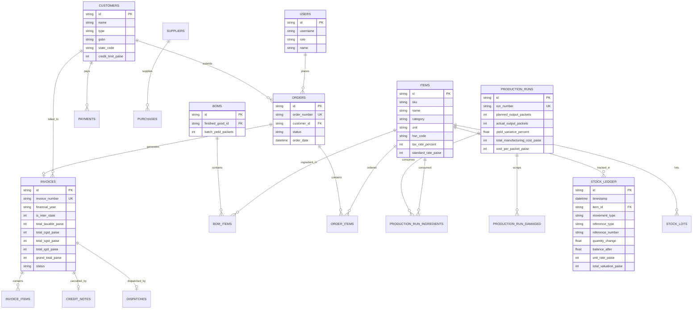

# DESIGN NOTE: Order-to-Audit System for a Small Food Manufacturer
**Centre for Digital Infrastructure, NIT Tiruchirappalli — Winter Internship Technical Submission**

---

## 1. Executive Summary & Architecture Overview

This project implements an end-to-end Order-to-Audit system for a packaged South Indian snack manufacturer (*Sri Krishna Foods Pvt Ltd*, Tamil Nadu). The core architectural achievement is seamlessly bridging two foundational operational loops at the finished-goods nexus:
1. **The Sales Loop:** Field Salesman Mobile Order $\rightarrow$ Admin Verification $\rightarrow$ GST Tax Invoice $\rightarrow$ Dispatch (Finished goods stock decrements) $\rightarrow$ Receivables & Collections.
2. **The Production Loop:** Raw Material Receipt $\rightarrow$ Recipe-based Bill of Materials (BOM) Issue $\rightarrow$ Manufacturing Execution $\rightarrow$ Finished Packets Produced (Finished goods stock increments) $\rightarrow$ Planned vs. Actual Variance & Costing.

The system is built on **Clean Architecture** principles, maintaining strict separation between the Domain Layer (pure business entities, value objects, domain events, and strategy interfaces), the Application Layer (use-case orchestrators), the Infrastructure Layer (SQLite relational persistence, PDF generators, and Excel/Tally exporters), and the Presentation Layer (REST controllers and responsive React client).

```
┌────────────────────────────────────────────────────────┐
│                   Presentation Layer                   │
│   (Salesman Mobile, Admin Desk, Floor Staff, Auditor)  │
└───────────────────────────┬────────────────────────────┘
                            │
┌───────────────────────────▼────────────────────────────┐
│                   Application Layer                    │
│ (OrderService, BillingService, ProductionService, etc.)│
└───────────────────────────┬────────────────────────────┘
                            │
┌───────────────────────────▼────────────────────────────┐
│                     Domain Layer                       │
│  - Value Objects: Money (Paise), Quantity, Unit        │
│  - Strategies: IGstTaxStrategy, ICostValuationStrategy │
│  - Entities: Item, BOM, Order, Invoice, StockLedger    │
└───────────────────────────▲────────────────────────────┘
                            │
┌───────────────────────────┴────────────────────────────┐
│                  Infrastructure Layer                  │
│  (SQLite DB with WAL & FKs, PDFKit, XLSX, Tally XML)   │
└────────────────────────────────────────────────────────┘
```

---

## 2. Low-Level Design (LLD), SOLID Principles & Design Patterns

### 2.1 SOLID Principles Adherence
- **Single Responsibility Principle (SRP):** Distinct application services handle isolated domains—`BillingApplicationService` handles invoicing and GST compliance, `ProductionApplicationService` calculates yields and overhead costing, and `InventoryApplicationService` maintains the double-entry movement ledger.
- **Open/Closed Principle (OCP):** Tax calculation and cost valuation use the **Strategy Pattern**. Adding a new tax rule (e.g., Union Territory GST or Export 0%) or inventory method (e.g., LIFO) requires implementing `IGstTaxStrategy` or `ICostValuationStrategy` without modifying existing core code.
- **Liskov Substitution Principle (LSP):** `FIFOValuationStrategy`, `WeightedAverageStrategy`, and `LastPurchaseValuationStrategy` are interchangeable through `ICostValuationStrategy`.
- **Interface Segregation Principle (ISP):** Repositories are split into domain-specific interfaces (`IStockLedgerRepository`, `IOrderRepository`, `IInvoiceRepository`, `IAuditRepository`).
- **Dependency Inversion Principle (DIP):** Application use-cases depend purely on abstract interfaces defined in `application/interfaces/IRepositories.ts`, with concrete SQLite implementations injected at runtime.

### 2.2 Design Patterns Employed
1. **Value Object Pattern (`Money`, `Quantity`, `Unit`):** Eliminates floating-point rounding errors. Monetary arithmetic is executed entirely in integer `paise` (1 INR = 100 paise).
2. **Strategy Pattern (`GstTaxService`, `ICostValuationStrategy`):** Decouples calculation algorithms from domain workflows.
3. **Double-Entry Stock Ledger Pattern:** Stock balances are **never** blindly overwritten. Current stock is derived from or reconciled against `SUM(quantity_change)` across immutable `StockLedgerEntry` records.
4. **Observer / Domain Event Pattern (`DomainEventPublisher`):** Publishes domain events (`OrderApprovedEvent`, `ProductionRunCompletedEvent`) for decoupling audit logging and auxiliary side-effects.

---

## 3. Relational Data Model (ER Diagram)



---

## 4. BOM Consumption & Variance Computation Engine

### 4.1 Recipe & Yield Mathematics
For Murukku 200g, 1 standard batch produces 200 packets:
- **Batch Scaling Ratio ($R$):**
  $$R = \frac{\text{Flour Issued}}{\text{Standard Flour per Batch}} = \frac{40\text{ kg}}{40\text{ kg}} = 1.0$$
- **Planned Output ($\hat{Y}$):**
  $$\hat{Y} = R \times 200 = 200\text{ packets}$$
- **Yield Variance ($\Delta Y$):**
  $$\Delta Y = \left(\frac{Y_{\text{actual}} - \hat{Y}}{\hat{Y}}\right) \times 100 = \left(\frac{188 - 200}{200}\right) \times 100 = \mathbf{-6.0\%}$$
  *Because $|\Delta Y| > 3.0\%$, the system flags a **Yield Variance Alert**.*

### 4.2 Ingredient Consumption Variance
- Standard Cooking Oil for $R = 1.0$ is $10.0\text{ L}$.
- Actual Cooking Oil issued $= 10.5\text{ L}$.
- **Oil Consumption Variance ($\Delta C_{\text{oil}}$):**
  $$\Delta C_{\text{oil}} = \left(\frac{10.5 - 10.0}{10.0}\right) \times 100 = \mathbf{+5.0\%}$$
  *Because $|\Delta C_{\text{oil}}| > 3.0\%$, the system flags a **Material Consumption Alert**.*

---

## 5. Costing & Valuation Methodology

The system computes direct material costs from acquisition lots using configurable strategies:

### 5.1 FIFO Valuation (Primary Benchmark Method)
1. **Flour (40 kg issued):** Sourced from opening lot (100 kg @ ₹42/kg) $\rightarrow 40 \times 42 = \mathbf{₹1,680.00}$.
2. **Cooking Oil (10.5 L issued):** Sourced from opening lot (30 L @ ₹140/L) $\rightarrow 10.5 \times 140 = \mathbf{₹1,470.00}$.
3. **Salt & Spice Mix (1.2 kg issued):** Sourced from opening lot (5 kg @ ₹200/kg) $\rightarrow 1.2 \times 200 = \mathbf{₹240.00}$.
4. **Pouches Consumed (194 pcs: 188 good + 6 damaged):** @ ₹2.50 $\rightarrow 194 \times 2.50 = \mathbf{₹485.00}$.
5. **Cartons Consumed (9 pcs):** @ ₹15.00 $\rightarrow 9 \times 15.00 = \mathbf{₹135.00}$.
- **Total Direct Materials Cost ($M$):**
  $$M = 1680 + 1470 + 240 + 485 + 135 = \mathbf{₹4,010.00}$$
- **Direct Manufacturing Overheads ($O$):**
  $$O = \text{Labour (₹1,200)} + \text{Power/Gas (₹600)} = \mathbf{₹1,800.00}$$
- **Total Manufacturing Cost ($TC$):**
  $$TC = M + O = ₹4,010 + ₹1,800 = \mathbf{₹5,810.00}$$
- **Approximate Cost Per Packet ($C_{\text{packet}}$):**
  $$C_{\text{packet}} = \frac{TC}{Y_{\text{actual}}} = \frac{₹5,810}{188} = \mathbf{₹30.90\text{ per packet}}$$
- **Gross Profit Margin (@ ₹50 Selling Price):**
  $$\text{Margin} = ₹50.00 - ₹30.90 = \mathbf{₹19.10\text{ (38.2\%)}}$$

### 5.2 Weighted Average Cost Alternative
- Flour: Opening (100 kg @ ₹42) + Purchase (60 kg @ ₹45) $= ₹6,900 / 160\text{ kg} = \mathbf{₹43.125/\text{kg}}$.
- 40 kg flour cost $= ₹1,725.00$. Total materials $= ₹4,055.00$. Total run $= ₹5,855.00$.
- Cost per packet $= \mathbf{₹31.14}$.

---

## 6. Audit Trail & Legal Invoicing Compliance

- **Immutable Stock Movements:** Every stock change creates a `StockLedgerEntry` referencing a source document (`PO`, `PR`, `INV`).
- **No In-Place Deletions:** In accordance with statutory GST and financial audit requirements, issued tax invoices can never be deleted; cancellation issues a formal **Credit Note** (`CN/2026-27/0001`).
- **Place of Supply GST Engine:** Automatically maps CGST (2.5%) + SGST (2.5%) for intra-state supplies (TN 33 $\rightarrow$ TN 33) and IGST (5.0%) for inter-state supplies (TN 33 $\rightarrow$ KA 29).
